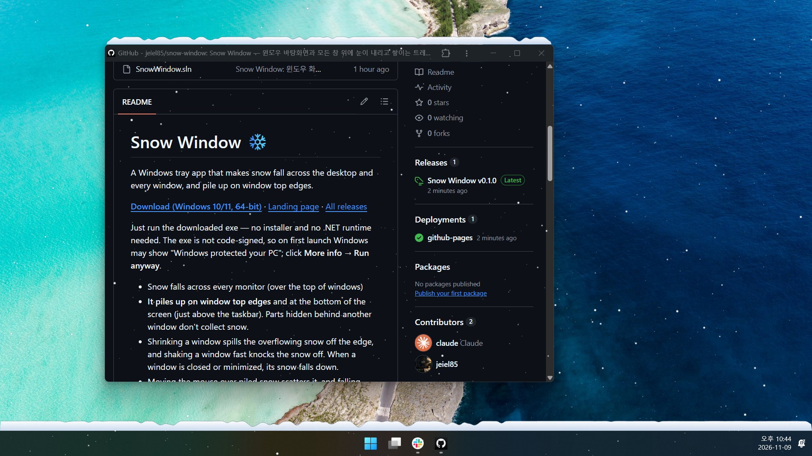

# Snow Window ❄️

A Windows tray app that makes snow fall across the desktop and every window, and pile up on window top edges.

**[Download (Windows 10/11, 64-bit)](https://github.com/jeiel85/snow-window/releases/latest/download/SnowWindow-win-x64.exe)** · [Landing page](https://jeiel85.github.io/snow-window/) · [All releases](https://github.com/jeiel85/snow-window/releases)



Just run the downloaded exe — no installer and no .NET runtime needed. The exe is not code-signed, so on first launch Windows may show "Windows protected your PC"; click **More info → Run anyway**.

- Snow falls across every monitor (over the top of windows)
- **It piles up on window top edges** and at the bottom of the screen (just above the taskbar). Parts hidden behind another window don't collect snow.
- Shrinking a window spills the overflowing snow off the edge, and shaking a window fast knocks the snow off. When a window is closed or minimized, its snow falls down.
- Moving the mouse over piled snow scatters it, and falling flakes get swept aside by the cursor.
- Mouse and keyboard input passes straight through, so it never gets in the way of your work.
- Snow pauses automatically on a monitor where a full-screen video or game is running.

## Usage

Right-click the snowflake icon in the notification area to open the menu. Left-click toggles the snow on and off.

| Menu item | Description |
|---|---|
| Snow (눈 내리기) | Turn snow on/off |
| Snow amount (눈의 양) | Light (조금) / Normal (보통) / Heavy (펑펑) |
| Scatter snow with mouse (마우스로 눈 흩날리기) | Turn mouse interaction on/off |
| Smooth motion (부드러운 움직임, 60fps) | Default is 30fps. 60fps is smoother but roughly doubles the CPU and GPU load |
| Clear piled snow (쌓인 눈 치우기) | Removes all piled snow |
| Snow only when it snows outside (밖에 눈 올 때만 내리기) | Weather mode. Checks the local weather every 15 minutes and snows only while it is snowing outside, as much as outside (light / moderate / heavy). While it is on, Snow and Snow amount are greyed out, and left-clicking the icon shows the current weather |
| Install update (업데이트 설치) | Appears at the top of the menu when a newer release is on GitHub. Downloads, verifies and swaps in the new exe, then restarts |
| Update → Check now / Check automatically (업데이트 → 지금 확인 / 자동으로 확인) | Checks GitHub for a newer release now / once a day (on by default) |
| Run at Windows startup (Windows 시작 시 실행) | Registers/unregisters `HKCU\...\Run`. While it is on, each launch points the entry at the exe you just ran, so moving or replacing the exe keeps it working |
| Open log folder (로그 폴더 열기) | `%LOCALAPPDATA%\SnowWindow` |

Settings are saved in `%APPDATA%\SnowWindow\settings.json`.

## Updates

About a minute after launch and then once a day, Snow Window reads the latest release of this repository from the GitHub API. When a newer version exists it shows a notification and an **Install update** item at the top of the tray menu. Nothing is installed until you click it. Installing:

1. downloads `SnowWindow-win-x64.exe` next to the running exe (`SnowWindow.exe.download`),
2. checks its size, its SHA-256 against the digest GitHub publishes for the asset, and its file version against the release tag,
3. renames the running exe to `SnowWindow.exe.old`, moves the new one into place and restarts (the `.old` file is deleted on the next check).

If the exe sits in a folder you cannot write to, or you run a development build, it opens the release page instead. Notifications that have moved to the Windows notification center can't be clicked through to the app, so use the tray menu item.

## Network and privacy

| When | Where | What is sent |
|---|---|---|
| Update check (daily, can be turned off) | `api.github.com`, `github.com` | Your IP address and `User-Agent: SnowWindow/<version>` |
| Weather mode, location (when turned on, then daily) | `ipapi.co` (fallback `ipwho.is`) | Your IP address, to look up an approximate city |
| Weather mode, weather (every 15 minutes) | `api.open-meteo.com` | Latitude/longitude rounded to 2 decimals (~1 km) |

Nothing else leaves your PC. Weather data by [Open-Meteo.com](https://open-meteo.com/) (CC BY 4.0).

## Build and run

Requirements: Windows 10 1607 or later, .NET 10 SDK

```bash
dotnet build SnowWindow.sln -c Release
dotnet test SnowWindow.sln
```

Executable: `src/SnowWindow/bin/Release/net10.0-windows/win-x64/SnowWindow.exe`

## Releasing

1. Bump `<Version>` in `src/SnowWindow/SnowWindow.csproj` (and the version shown on the landing page) and merge it to `main`.
2. Push a matching tag, e.g. `git tag v0.1.1 && git push origin v0.1.1`.
3. The `Release` workflow checks that the tag matches `<Version>`, runs the tests, builds a single self-contained exe (about 50 MB) and publishes a GitHub release with it as `SnowWindow-win-x64.exe` plus its SHA-256. The download links on the landing page and in this README point to that asset name, so keep it.

To build the same exe locally:

```bash
dotnet publish src/SnowWindow -c Release -r win-x64 --self-contained true -p:PublishSingleFile=true -p:EnableCompressionInSingleFile=true -p:IncludeNativeLibrariesForSelfExtract=true -o publish
```

`CI` builds and tests every push to `main` and every pull request.

The landing page is the single file `docs/index.html`, served by GitHub Pages from the `/docs` folder on `main`.

## Diagnostics

- `SnowWindow.exe --dump-windows > windows.txt`: prints which windows are recognized as snow-holding (`[snow]`) and which only occlude (`[    ]`)
- Environment variable `SNOWWINDOW_PROFILE=1`: writes per-stage frame timings to the log every 10 seconds

## How it works

```
SnowEngine (dedicated thread, 30/60fps)
 ├─ WindowChangeWatcher  Detects window moves/show/hide/z-order changes via WinEvent → rescans only when something changed (and every second as a safety net)
 ├─ WindowTracker        Collects the window list (z-order, actual DWM borders) with EnumWindows
 ├─ SnowSimulation       Flakes, landing, piles (per-column heightmaps), avalanche smoothing, spill-off, mouse scattering. No Win32 dependency → covered by unit tests
 └─ SnowRenderer         One transparent click-through topmost window per monitor + DirectComposition swap chain + Direct2D (sprite batches for flakes)
TrayApp (UI thread)      Tray menu, settings save, startup registration
```

- The overlay window uses `WS_EX_NOREDIRECTIONBITMAP | WS_EX_LAYERED | WS_EX_TRANSPARENT | WS_EX_TOPMOST`, so it has no GDI buffer and lets mouse input through.
- All coordinates are physical pixels on a Per-Monitor V2 basis.
- `tools/make_icon.py` generates the app icon (`src/SnowWindow/Assets/snow.ico`).
